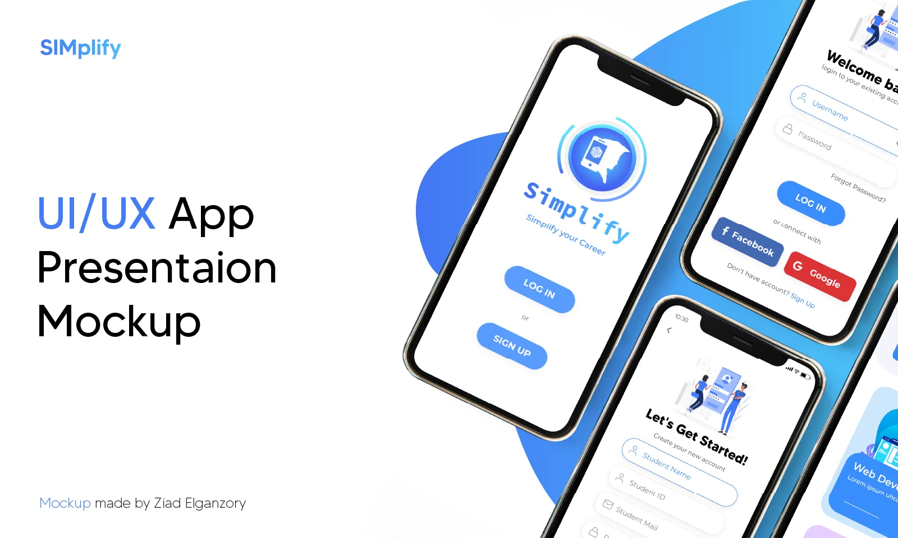
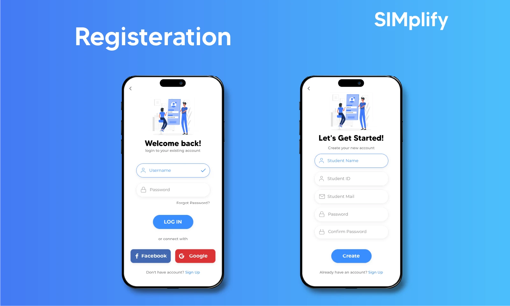
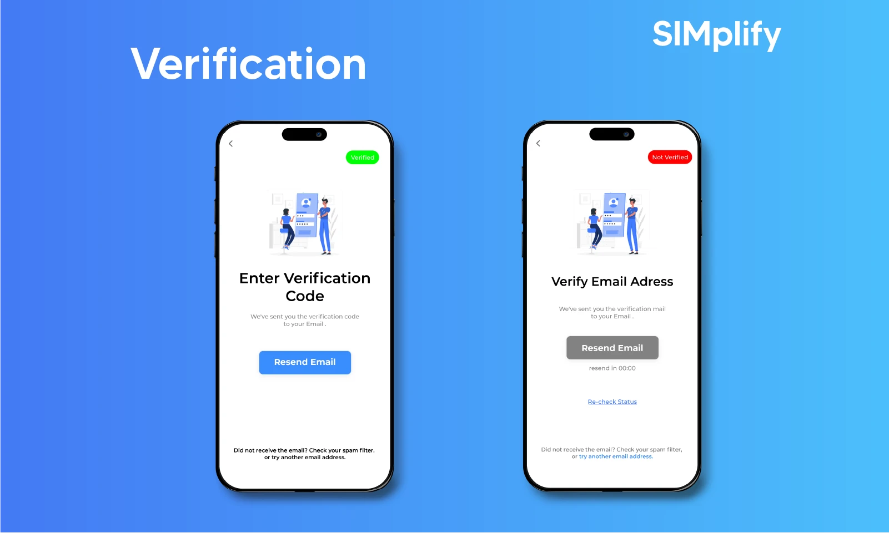
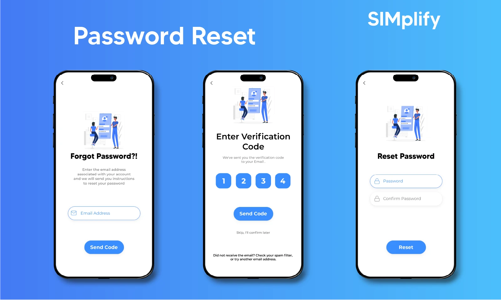
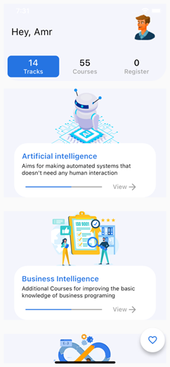
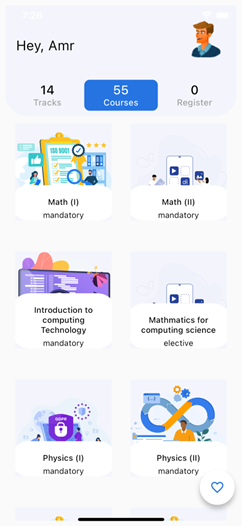
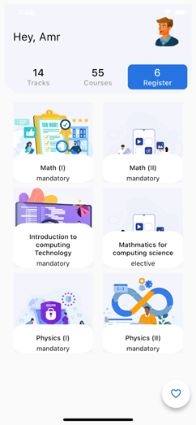

# SIMplify
### *Simplify Your Career*

**A Student Information & Career Management Mobile App — SIM Department**

---

## Table of Contents

- [Overview](#overview)
- [Motivation & Problem Statement](#motivation--problem-statement)
- [Goals](#goals)
- [Development Methodology](#development-methodology)
- [Requirements](#requirements)
- [System Design](#system-design)
- [App Screens](#app-screens)
  - [Splash Screen](#-splash-screen)
  - [Sign Up](#-sign-up)
  - [Email Verification](#-email-verification)
  - [Forgot Password](#-forgot-password)
  - [Reset Password](#-reset-password)
  - [Home — Tracks Tab](#-home--tracks-tab)
  - [Home — Courses Tab](#-home--courses-tab)
  - [Home — Register Tab](#-home--register-tab)
  - [Pick Fields](#-pick-fields)
  - [Profile — Score Tab](#-profile--score-tab)
  - [Profile — Passed Courses Tab](#-profile--passed-courses-tab)
  - [Profile — Active Courses Tab](#-profile--active-courses-tab)
  - [Course Detail & Admin Controls](#-course-detail--admin-controls)
  - [Attach Professor — Success Dialog](#-attach-professor--success-dialog)
- [Design Mockups](#design-mockups)
- [Tech Stack & Architecture](#tech-stack--architecture)
- [Core Algorithms](#core-algorithms)
- [Database Schema](#database-schema)
- [Industry Research](#industry-research)
- [Survey Findings](#survey-findings)
- [Future Work](#future-work)

---

## Overview

SIMplify is a cross-platform mobile application developed as a **Senior Project** for the **Systems & Information Management (SIM) Department**. It serves as a single unified platform for students to manage their academic journey — from course registration and GPA tracking, to personalized career roadmaps and curated learning resources. The app also includes an **Admin panel** embedded within the same interface, allowing academic staff to manage course enrollment, attach professors, and control course availability.

---

## Motivation & Problem Statement

Students in the SIM department face three recurring challenges:

1. **Confusion about the department system** — New students struggle to understand the credit-hour system, available courses, prerequisites, and their ranking within their batch. SIMplify solves this with a clear visual roadmap and simplified department overview.

2. **Graduation anxiety** — Without visibility into how many hours remain or where they stand academically, students worry about graduating on time. SIMplify addresses this with a real-time GPA tracker, CGPA display, and academic standing breakdown.

3. **Inefficient course registration** — Students waste significant time at the start of each semester figuring out which courses to take and where to find materials. SIMplify streamlines enrollment and provides instant access to course content.

---

## Goals

**Core Goals**
- Full control over student course materials and prerequisite lists
- Personalized career track recommendations via a content-based algorithm
- Tools to ensure on-time graduation (GPA calculator, credit hour tracker, academic standing)
- Clear descriptions for every course and field in the SIM department
- Simplified online course registration and withdrawal

**Planned Future Features**
- Chat System between students and staff
- Push Notification System
- College Payment System
- Daily News Feed
- Live Lectures streaming
- Student Feedback Page

---

## Development Methodology

The project follows the **Agile methodology**, chosen for its:
- Continuous and incremental software delivery
- Ability to incorporate stakeholder feedback within each Sprint
- Daily collaboration between developers and project owners
- Flexibility to handle changing requirements at any stage

---

## Requirements

### Functional Requirements

1. **User Authentication** — Secure account creation, login, OTP-based email/phone verification, and password reset
2. **Course Catalog** — Full listing of all courses with descriptions, schedules, and required materials
3. **Course Overview** — Detailed view of each course's content, objectives, and importance
4. **Educational Resources** — Access to lectures, readings, assignments, and external links per course
5. **Career Connections** — Information on career paths and job opportunities tied to each course
6. **Student Profiles** — Customizable profiles reflecting academic records, skills, and experience
7. **Personalized Recommendations** — Course/track suggestions based on the student's interests and academic history
8. **Grade Tracking** — View and monitor grades for all enrolled courses
9. **CGPA & Credit Hours** — Real-time display of cumulative GPA and total earned credit hours
10. **Academic Standing** — Detailed breakdown of mandatory and elective credit hour progress
11. **Admin Controls** — Ability for staff to attach professors/TAs to courses and open/close enrollment
12. **User Feedback** — Mechanism for students to submit suggestions

### Non-Functional Requirements

- **Performance** — Handles high traffic without delays or downtime
- **Scalability** — Scales up or down based on demand
- **Security** — Protected against hacking, malware, and data breaches
- **Usability** — Intuitive, user-friendly interface with minimal learning curve
- **Accessibility** — Follows best practices for mobile accessibility
- **Reliability** — Minimal downtime and error rate
- **Maintainability** — Clean, well-documented, and modular codebase
- **Testability** — Robust testing framework throughout the app

---

## System Design

The project includes the following design artifacts:

- **Use Case Diagrams** — Covering all major interactions (login, registration, course enrollment, recommendations)
- **Entity Relationship Diagram (ERD)** — Full relational model of all database entities
- **Sequence Diagrams** — For Sign Up, Login, Register Course, Show Registered Courses, and Recommendation flows
- **Data Flow Diagrams** — DFD Level 0 (Context Diagram) and DFD Level 1 (Process Decomposition)
- **UML Class Diagrams** — Object-oriented model of the application's core classes
- **Architecture** — MVVM pattern with BLoC state management

---

## App Screens

### 📝 Sign Up

The registration screen collects all required student details in a single form: **Name**, **Student Mail**, **Phone Number**, **Student ID**, **Password**, and **Confirm Password**. The form applies real-time front-end validation before submitting to the backend. On success, the user's Bearer token is stored locally to avoid repeated credential prompts in future sessions.

---

### ✉️ Email Verification

After registration, the user is directed to a 4-digit OTP entry screen. The code is delivered to the student's registered email or phone number via Vonage. A countdown timer shows how long before the code can be resent ("Resend code after 1:25"), and a **Verify** button submits the code for server-side validation. The OTP is valid for 3 minutes.

---

### 🔑 Forgot Password

If a student forgets their password, they enter their registered email address on this screen and tap **Send Code**. The backend generates a random OTP and dispatches it via the Vonage SMS service to trigger the reset flow.

---

### 🔒 Reset Password

The final step of the password recovery flow. The student sets a new **Password** and confirms it in the **Confirm Password** field. Both fields show inline validation errors ("can not be empty") when submitted blank, and the **Reset** button triggers the update on the backend once both fields pass validation.

---

### 🏠 Home — Tracks Tab

## System Architecture

  
  
  

The Home screen opens on the **Tracks** tab (14 Tracks total), which is powered by the content-based recommendation algorithm. Each card shows a career track name, a short description of what it prepares the student for, and a **View →** link. Tracks shown here include **Artificial Intelligence** ("Aims for making automated systems that doesn't need any human interaction") and **Business Intelligence** ("Additional Courses for improving the basic knowledge of business programming"). A floating heart icon allows students to save favourite tracks.

---

### 📚 Home — Courses Tab

Switching to the **Courses** tab (55 Courses total) displays all available department courses in a scrollable grid. Each card shows the course name and whether it is **mandatory** or **elective**. Courses visible here include Math (I), Math (II), Introduction to Computing Technology, Mathematics for Computing Science, Physics (I), and Physics (II), each represented by a distinct illustration.

---

### 📋 Home — Register Tab

The **Register** tab highlights courses available for enrollment this semester (6 shown in this view). The same course grid is displayed, but now courses the student qualifies for — based on prerequisite completion and admin availability settings — are actionable for enrollment or withdrawal. The tab counter updates dynamically as the student registers or drops courses.

---

### 🎯 Pick Fields

The field selection screen ("Hey, Pick Fields") is the starting point for the recommendation engine. The student has **2 My Favorites** already selected and can browse **14 additional fields** to add. Each field card includes a name and a brief description of what it aims for. Fields visible here include **Artificial Intelligence** and **Cloud Engineering**. The ratings assigned to these fields seed the content-based recommendation matrix that generates personalized course and track suggestions.

---

### 👤 Profile — Score Tab

The **Score** tab on the Profile page (shown here for Admin user "Ziad Hammed") provides a complete academic standing overview:

- **CGPA**: 3.20 out of 4, displayed as a filled progress bar
- **Completed Hours**: 58, shown as a progress bar
- **Academic Standing** breakdown:
  - Mandatory University: 8 out of 10
  - Elective University: 6 out of 6
  - Mandatory SIM: 26 out of 32
  - Elective SIM: 55 out of 88
  - Free Elective: 4 out of 4

This breakdown gives students a precise understanding of exactly which credit-hour categories they still need to fulfill before graduation.

---

### 🎓 Profile — Passed Courses Tab

The **Passed Courses** tab displays all courses the student has successfully completed, presented as a grid of cards. Each card shows the course name and a **GPA badge** (all showing 3 in this view), allowing students to review their historical performance per course at a glance. Courses shown include Mathematics for Computing, Physics (I), Introduction to Probability, Computer Programming, Math (III), and Software Engineering.

---

### 📖 Profile — Active Courses Tab

The **Active Courses** tab lists all courses the student is currently enrolled in for the semester. Each course is displayed as a tile with an illustrative icon. Courses visible in this view include **Math (I)**, **Math (II)**, **Introduction to Computing**, **Physics (II)**, and **Software Requirements**. This tab gives students a quick overview of their current academic workload.

---

### 📄 Course Detail & Admin Controls

The Course Detail page provides full information about a selected course. Shown here for **Math (I)**:

- **Duration**: 2 Hours
- **Course Code**: 4170101
- **Description**: "Covers fundamental mathematical concepts and techniques, such as algebra, calculus, geometry, and trigonometry"

For **Admin users**, two additional dropdown controls appear:
- **Attach Professors** — Assign professors responsible for the course
- **Attach Teaching Assistants** — Assign TAs to support the course

A green **Open Enrollment** button at the bottom allows the admin to open the course for student registration. Students can only enroll in a course once the admin sets it to available **and** they have completed all prerequisites.

---

### ✅ Attach Professor — Success Dialog

When an admin successfully attaches a professor to a course, a confirmation dialog appears with a green checkmark and the message **"Success — Attached Shimaa Elmorsy"**. Below the dialog, the updated professor list is visible, showing the names and roles of all attached staff  — all professors). Tapping **Okay** dismisses the dialog.

---

## Design Mockups

The following screens represent the high-fidelity Figma UI/UX design mockups created before development, showcasing the intended visual language of the app.

### Landing Page Mockup

Clean white-centered layout with the SIMplify logo and two primary CTAs (LOG IN / SIGN UP) against the app's signature blue gradient background.

---

### Registration Mockup

Side-by-side view of the **Login** screen (left, with Facebook and Google social auth options) and the **Sign Up** screen (right, collecting student academic identity fields). Designed with rounded input fields and a clear visual hierarchy.

---

### Profile Page Mockup

Three-state profile design showing the **Score** tab (CGPA + Completed Hours progress bars), **Badges** tab (grid of achievement badges for completed courses), and **Survey** tab (displaying the student's recommended specialization with a retake button).

---

### Content Catalog Mockup

**Left**: Drill-down view of the Web Development track showing individual technology courses (HTML, CSS, JavaScript) with enrollment status. **Center/Right**: The full Course Catalog grid displaying all available tracks (Front End, Backend, DevOps) with color-coded cards and enrolled student counts.

---

## Tech Stack & Architecture

### Mobile (Flutter)

| Component | Technology |
|---|---|
| Framework | Flutter / Dart |
| State Management | BLoC (Business Logic Component) |
| Architecture Pattern | MVVM + Singleton |
| HTTP Client | `dio` |
| Responsive UI | `flutter_screenutil` |
| Local Storage | `shared_preferences` |
| Web Content | `webview_flutter` |
| File Downloads | `flutter_file_downloader` |
| SVG Assets | `flutter_svg`, `websafe_svg` |

> Flutter was selected for its **SKIA rendering engine** integration, which eliminates the JavaScript bridge layer present in competing frameworks and delivers near-native performance from a single codebase on both iOS and Android.

**State Management — BLoC:** Actively separates the business logic layer from the UI, making the codebase maintainable, testable, and scalable. Events trigger state changes that the UI reacts to, with zero coupling between layers.

### Backend (Laravel)

| Component | Technology |
|---|---|
| Framework | Laravel (PHP) |
| Database | MySQL |
| API Auth | Laravel Sanctum (token-based) |
| Roles & Permissions | Laravel Spatie |
| Excel Handling | Laravel Maatwebsite |
| OTP / SMS | Vonage |
| Email Testing | Mailtrap |

---

## Core Algorithms

### 1. Content-Based Recommendation System

The recommendation engine suggests career tracks and courses based on a student's stated field interests.

**Step 1 — Student field ratings:** The student rates their interest in each field (Design, Programming, Web, Cloud, etc.) on a scale of 0 to 1 via the Pick Fields screen.

**Step 2 — Course field attributes:** Each course in the system has a pre-defined attribute vector indicating how strongly it relates to each field.

**Step 3 — Score computation:** The student's ratings matrix is multiplied against the course attributes matrix to produce a recommendation score per course. Higher scores indicate stronger recommendations.

This is a **content-based filtering** approach — recommendations derive from item attributes rather than other users' behavior, which is ideal for a specialized academic use case.

---

### 2. GPA & CGPA Calculator

The `CalcGpaManLogic` function is triggered whenever a student registers, unregisters, or changes a course status (Active / Finished / Failed):

1. Fetch the student's finished courses for the term
2. Multiply each course grade × its credit hours
3. Apply the standard GPA equation to derive the term GPA

The `CalcCgpa` function then:
1. Fetches GPA values for all completed terms
2. Applies the CGPA equation across all terms
3. Updates the Profile Score display in real time

---

### 3. OTP Authentication (Two-Factor Auth)

A two-step phone/email verification flow powered by Vonage:

1. **sendOtp** — Generates a random 4-digit code and delivers it via SMS to the student's registered phone number
2. **byPhoneVerify** — Accepts the user-entered code (valid for 3 minutes) and passes it to `compareOtp()`, which validates it against the database-stored value

---

### 4. Course Availability & Prerequisite Filter

A student can only enroll in a course if **both** conditions are met:
- The admin has explicitly set the course status to **Available** (via the Open Enrollment button)
- The student has **completed all prerequisite courses** for that course

The `availableCourses` function enforces these conditions server-side before returning any enrollable courses to the client.

---

## Database Schema

| Table | Description |
|---|---|
| `users` | Authentication credentials (email, password, tokens) |
| `students` | Full student profile data |
| `academic_staffs` | All academic staff (professors and teaching assistants) |
| `courses` | All SIM courses and their prerequisite relationships |
| `course_student` | Enrollment relationship between students and courses |
| `course_field` | Relationship mapping courses to their career fields |
| `fields` | Available career fields (Web Dev, AI, DevOps, etc.) |
| `field_student` | Fields a student has rated/selected |
| `recommendations` | Output of the content-based recommendation algorithm |
| `staff_responsible_on_courses` | Assignment of academic staff to specific courses |
| `terms` | Per-term GPA results for each student |

---

## Industry Research

As part of the project research phase, the team conducted direct interviews with professionals at multiple Alexandria-based tech companies to validate the app's direction and understand what the job market actually requires from SIM graduates.

**Companies visited:** Enozom · Incorta · Triangle Z · Rubikal · Inova EG · Pharos Solutions · Silicon Mind · Arab Computers · IT Wolf Solutions · Heebr

**Key takeaways that shaped the app:**

- Technical skills win the interview — communication skills win the job. Both are non-negotiable.
- Employers strongly prefer students who focused on **one track** during university rather than those who spread themselves thin across many.
- **Practical, hands-on courses** are valued more than theoretical ones by every company interviewed.
- Fresh graduates learn more in **startups** where they own entire features, compared to large corporations where responsibilities are fragmented.
- Mentorship quality and team environment matter more than salary in the first 1–3 years.
- Only approximately **1% of applicants** get hired at competitive companies — strong portfolios built during university are essential.
- **Modern technologies** (Flutter, UI/UX, Cloud) are in higher demand than legacy tools.
- **AI/ML** is globally in demand but less prevalent in the Egyptian market — students must research local conditions before committing.

---

## Survey Findings

A student survey across the SIM department directly shaped the app's feature set:

| Survey Question | Result | Feature Built |
|---|---|---|
| Difficulty understanding the course system | 56.2% said yes | Visual course roadmap with prerequisites |
| Want course materials in the app | 94.2% said yes | Material upload section for instructors |
| Trouble understanding course importance | 62.8% said yes | Detailed course content descriptions |
| Want to know what field each course prepares for | 88.2% said yes | Field-of-work info on every course |
| Want external material links (YouTube, Udemy, etc.) | 90.6% said yes | Curated external resource links per course |
| Want a guide for what courses qualify them for | 90.0% said yes | Career roadmaps per programming role |
| Would like Arabic language support | 58.9% said yes | Planned for future release |
| Find the app idea useful | 93.8% said yes | Product direction validated |

---

## Future Work

- 💬 **Chat System** — Real-time messaging between students and academic staff
- 🔔 **Notifications** — Push notifications for deadlines, materials, and announcements
- 💳 **Payment System** — Integrated tuition and fee payment
- 📰 **Daily News** — Tech news and department updates feed
- 🎥 **Live Lectures** — Real-time lecture streaming within the app
- 🌐 **Arabic Localization** — Full Arabic language support (58.9% of students requested this)
- 🤝 **Feedback Page** — Structured feedback loop between students and faculty

---

**SIMplify — Senior Project**

Systems & Information Management Department

Built with ❤️ for SIM students — *Simplify your Career.*

